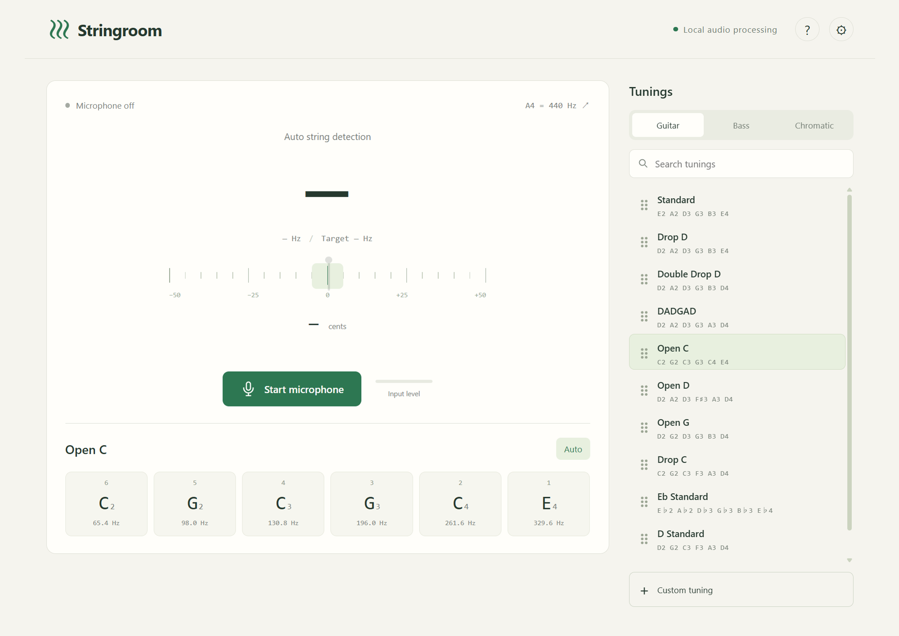

# Stringroom

吉他 / 贝斯调音器。Windows 10 / 11 x64，可离线使用。

[下载免安装版](https://github.com/Golden-Jinx/Guitar-Tuning/releases/download/v1.0.0/Stringroom-1.0.0-Windows-x64-Portable.exe) · [下载安装版](https://github.com/Golden-Jinx/Guitar-Tuning/releases/download/v1.0.0/Stringroom-1.0.0-Windows-x64-Setup.exe)

支持 Open C、DADGAD 等预设，也可以创建和编辑自己的调弦。支持搜索、拖动排序、双击琴弦听参考音。

打开后点击 **Start microphone**，选择调弦即可使用。自定义调弦可通过 **Export / Import** 迁移。

安装包未签名。[构建说明](docs/BUILD.md)
